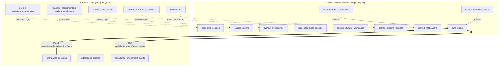

# Klasio / Attendly — Database Schema Blueprint & Redesign Reference

This folder contains the complete, executable database schemas for both the **PostgreSQL 16 backend (System of Record)** and the **SQLite mobile client (Offline-First Edge Store)**.

## Files in this Directory

| File | Engine | Role | Source / Extraction |
| :--- | :--- | :--- | :--- |
| [`postgres_schema.sql`](file:///home/dope/Documents/atten/schemas/postgres_schema.sql) | **PostgreSQL 16** | Central relational database, multi-tenant RBAC/ReBAC, academic records, finalized attendance, and audit logs | Extracted live from Docker container `atten_postgres` via `pg_dump -s` |
| [`sqlite_schema.sql`](file:///home/dope/Documents/atten/schemas/sqlite_schema.sql) | **SQLite 3 (Expo SQLite)** | Mobile edge offline store for camera scanning, face matching, cached rosters, and local draft sessions | Consolidated from [`database.ts`](file:///home/dope/Documents/atten/mobile/src/storage/database.ts) |

---

## 1. High-Level Architecture & Synchronization Model

---

## 2. Table-by-Table Cross-Database Mapping

| Backend PostgreSQL Table | Mobile SQLite Table | Sync Direction | Notes & Mapping Key |
| :--- | :--- | :---: | :--- |
| `users` | `local_auth_session` | Server → Mobile | Mobile caches current user JSON and JWT token (`id = 1`). |
| `student_enrollments` + `users` | `cached_rosters` | Server → Mobile | Keyed by `(teaching_assignment_id, student_user_id)`. Includes student institutional ID, name, and face registration state. |
| `student_face_profiles` | `cached_embeddings` | Server → Mobile | Keyed by `(student_user_id, model_version, sample_index)`. Stores raw binary Float32 ONNX embedding blobs (`embedding_blob`). |
| `attendance_sessions` | `local_attendance_sessions` | Bidirectional | Keyed by client-generated `client_session_uuid`. Enforces `UNIQUE(teaching_assignment_id, session_date, period_slot_or_sequence)`. |
| `attendance_records` | `local_attendance_records` | Mobile → Server | Foreign key to `local_attendance_sessions(client_session_uuid)`. Unique per `(client_session_uuid, student_user_id)`. |
| `attendance_amendment_audits` | `local_amendment_audits` | Mobile → Server | Audits manual corrections with `client_amendment_id` for deduplication. Enforces `amendment_reason >= 10 chars`. |
| — | `sync_queue` | Mobile Internal | Durable FIFO queue with exponential backoff for `SESSION_SYNC` and `AMENDMENT_SYNC`. |
| Materialized Views / Aggregates | `cached_student_attendance` | Server → Mobile | Overall percentage + JSON breakdown for student monthly calendar. |
| `attendance_records` history | `cached_student_subject_history`| Server → Mobile | Subject-wise historical attendance session records for student view. |
| `student_attendance_requests`| `cached_student_requests` | Bidirectional | Absence excuse / grievance workflow (`Sent`, `Being reviewed`, `Accepted`, `Not accepted`). |
| `notifications` | `cached_notifications` | Server → Mobile | Notification feed (`is_read`, `action_route`, `priority`). |

---

## 3. PostgreSQL Domain Breakdown (29 Tables)

### Multi-Tenancy & Access Control (RBAC & ReBAC)
1. **`institutions`**: Multi-tenant root (universities, colleges).
2. **`campuses`**: Physical campus sites tied to an institution.
3. **`departments`**: Academic units (e.g., Computer Science).
4. **`department_campuses`**: Many-to-many junction between departments and campuses.
5. **`users`**: Master user identity (username, email, password_hash, role_code, is_active).
6. **`institution_memberships`**: Scopes a user into one or more tenant institutions.
7. **`permissions`**: Granular system permissions (`attendance:finalize`, `reports:export`, etc.).
8. **`role_templates`**: Standard role definitions (`INST_ADMIN`, `FACULTY`, `STUDENT`).
9. **`role_permissions`**: Permission assignments to role templates.
10. **`role_assignments`**: Assigns roles to users with hierarchical inheritance.
11. **`role_assignment_scopes`**: Scoping constraints (institution-wide vs department-specific).
12. **`delegations`**: Temporary administrative or operational delegations.
13. **`delegation_permissions`**: Scoped permissions granted under active delegation.
14. **`delegation_scopes`**: Organizational boundaries for delegations.
15. **`authorization_audits`**: Complete immutable ledger of permission evaluations.

### Academic Core
16. **`academic_terms`**: Semesters / trimesters with date-range constraints (`chk_term_date_range`).
17. **`subjects`**: Courses offered with subject code, credit hours, and department.
18. **`class_sections`**: Student cohorts / sections within a term and department.
19. **`teaching_assignments`**: Links faculty, subject, class section, and academic term (operational pivot).
20. **`substitute_delegations`**: Explicit faculty substitution window for a teaching assignment.
21. **`student_enrollments`**: Enrollment of a student in a class section with start/end effective dates.

### Attendance & Auditing
22. **`attendance_sessions`**: Finalized sessions with applicability (`COUNTED`, `CANCELLED`, `EXEMPT`), payload hash, and counts.
23. **`attendance_records`**: Student-level marks (`PRESENT`, `ABSENT`, `EXCUSED`), source (`AI_VERIFIED`, `MANUAL_MARK`, `MANUAL_OVERRIDE`), and confidence.
24. **`attendance_amendment_audits`**: Post-finalization corrections with role verification, reason check, and idempotency key.
25. **`student_attendance_requests`**: Student grievance and correction request lifecycle.
26. **`report_export_audits`**: Tracks who exported attendance CSV/PDF reports, format, filters, and timestamps.

### Biometrics & Platform
27. **`student_face_profiles`**: 512-D / 128-D vector embeddings, model versioning, and registration state.
28. **`notifications`**: Recipient notification inbox with priorities and deep-linking action routes.
29. **`alembic_version`**: Schema migration tracking table.

---

## 4. SQLite Mobile Schema Breakdown (11 Tables)

1. **`local_auth_session`**: Single-row table (`CHECK(id = 1)`) storing the active JWT and user profile for immediate offline app boot.
2. **`cached_rosters`**: Students enrolled in the faculty's assignments, including registration status and eligibility dates.
3. **`cached_embeddings`**: High-performance local binary blob store (`embedding_blob BLOB`) for on-device cosine distance matching.
4. **`local_attendance_sessions`**: Offline drafts and finalized classroom sessions before sync.
5. **`local_attendance_records`**: Student status marks linked via foreign key cascade to sessions.
6. **`sync_queue`**: Transactional outbox pattern table with retry counters, next retry schedule, and unique operation indexes.
7. **`local_amendment_audits`**: Offline audit trail for attendance alterations made on the device.
8. **`cached_student_attendance`**: Pre-calculated summary percentages for student dashboard.
9. **`cached_student_subject_history`**: Historical timeline of attended vs missed classes per subject.
10. **`cached_student_requests`**: Offline cache for student absence explanation requests.
11. **`cached_notifications`**: Local notification feed indexed by recipient and timestamp.

---

## 5. Potential Redesign Considerations & Pain Points

When preparing schema revisions, here are key architectural observations and candidate areas for improvement:

### A. Embeddings Storage & Multi-Model Coexistence
- **PostgreSQL**: `student_face_profiles` stores embeddings as generic bytea or arrays. If moving toward pgvector on Postgres, consider native `vector(512)` or `vector(128)` column types with HNSW/IVFFlat indexing.
- **SQLite**: Stores `embedding_blob BLOB` with composite key `(student_user_id, model_version, sample_index)`. While performant for linear scans over small class rosters (e.g. 60 students × 3 samples = 180 embeddings), larger cohorts (>500 students) benefit from indexed quantizations or pre-normalized Float32 structures.

### B. Sync Queue & Outbox Idempotency
- `sync_queue` handles both `SESSION_SYNC` and `AMENDMENT_SYNC` via conditional unique indexes (`WHERE operation_type = 'SESSION_SYNC'`).
- **Opportunity**: If adding additional offline actions (e.g. offline student grievance submission, offline profile photo enrollment), consider generalizing the payload schema into a standard outbox event log with a discriminator column and generic UUID idempotency key.

### C. Substitute Delegations vs ReBAC Delegations
- The PostgreSQL schema contains two delegation concepts:
  1. `substitute_delegations`: Fast-path operational substitute teacher assignment for a specific class slot.
  2. `delegations` + `delegation_permissions` + `delegation_scopes`: Deep RBAC/ReBAC permission delegation engine.
- **Opportunity**: Consolidate or clarify the boundary between academic substitute teaching and administrative authority delegation.

### D. Multi-Tenancy Isolation (`institution_id`)
- Most core tables (`academic_terms`, `campuses`, `departments`, `subjects`, `users`) include `institution_id` for multi-tenant data partitioning.
- Ensure composite foreign keys or Row-Level Security (RLS) policies consistently enforce `institution_id` across `class_sections` and `teaching_assignments` to prevent cross-tenant data leaks.
